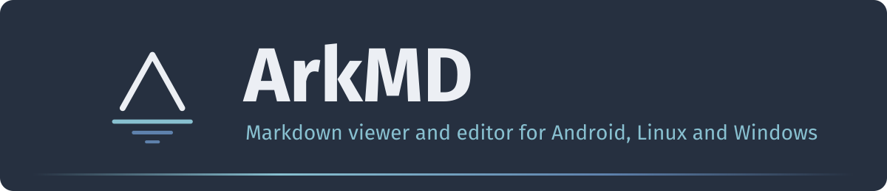
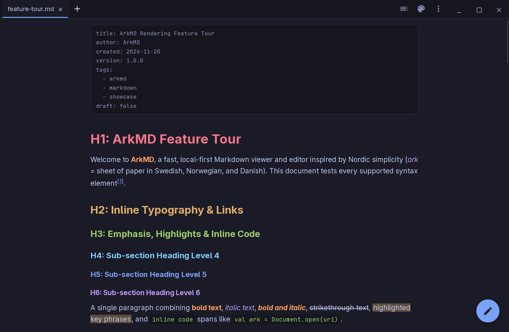
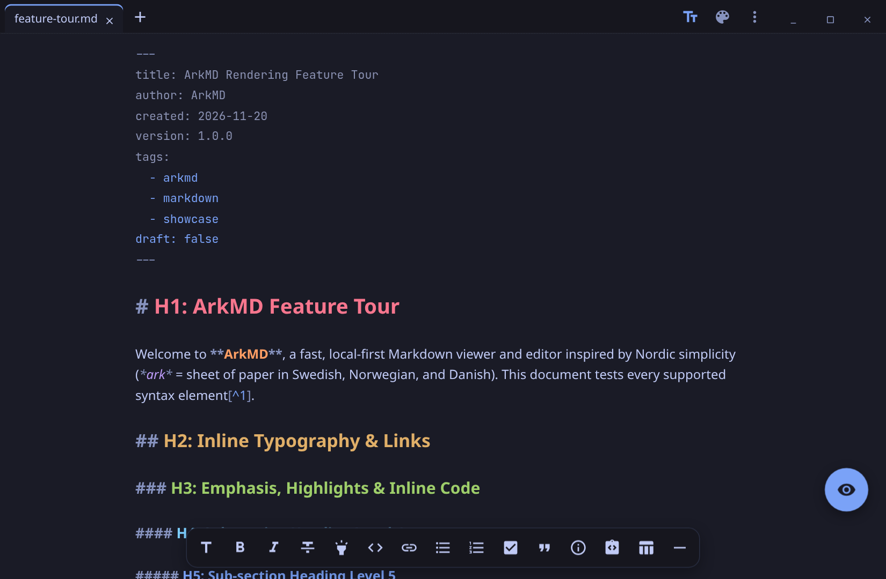
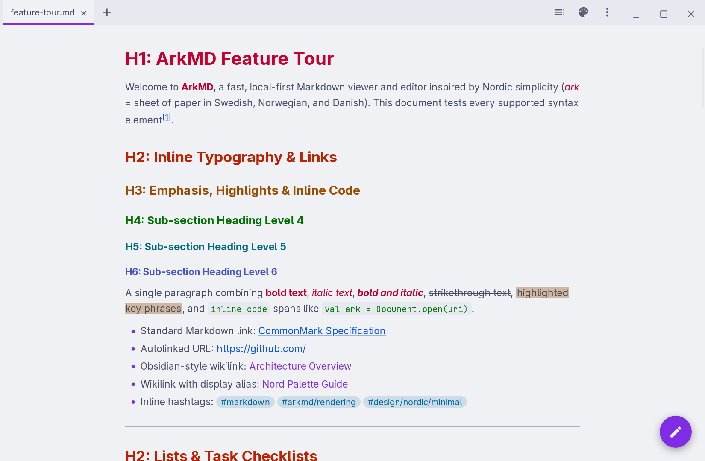

<h1 align="center"></h1>

<p align="center">
  <a href="https://github.com/cj0r/arkmd/releases/latest"></a>
  <a href="https://github.com/cj0r/arkmd/actions/workflows/tests.yml"></a>
  <a href="LICENSE"></a>
</p>

A lightweight Markdown viewer and editor for **Android, Linux and Windows**. Open a file, read it with Obsidian-style rendering, and switch to an editor with one tap. No vault, no plugins, no account. *Ark* is Danish and Norwegian for "a sheet of paper".



> [!WARNING]
> ArkMD **opens, edits and saves your Markdown files in place.** Saving overwrites the original: there is no autosave, backup copy or version history. Keep backups of anything you can't afford to lose, and read the [disclaimer](#disclaimer) before you rely on it.

## Features

- **Reader:** colored headings, callouts (including foldable ones), `==highlights==`, `[[wikilinks]]`, `#tags`, task lists, tables, footnotes, front matter and syntax-highlighted code blocks.
- **Editor:** CodeMirror 6 with live Markdown highlighting, including code inside fenced blocks. One tap (or Ctrl+E) switches between reading and editing and keeps your place. A file's line endings are kept.
- **Tabs:** several files open at once, each with its own text, undo history, cursor and scroll position. Close a tab with its ✕, middle-click, Ctrl+W or the Android back button; switch with Ctrl+Tab. Opening a file that is already open switches to its tab.
- **Formatting panel:** a floating bar that inserts headings, bold, italic, strikethrough, highlight, code, links, lists, tasks, quotes, callouts, code blocks, tables and dividers, so you don't need to know the syntax. Applying a format again removes it. The same formats have keyboard shortcuts (Ctrl+1 to 6 for headings, Ctrl+Shift+8 for bullets, and more; F1 lists them), and Tab steps a heading one level deeper or nests a list item.
- **Themes:** 21 dark and light themes in eight families (Tokyo Night, Catppuccin, Dracula, GitHub, Monokai, Rosé Pine, One Dark Pro, Nord), generated from the official palettes. Add your own from a CSS file of color variables.
- **Fonts:** separate reading and editing fonts: the system font, Fira Sans, Atkinson Hyperlegible, Source Serif 4, Lora, iA Writer Quattro, JetBrains Mono and Meslo LG, with sizes from 14 to 28. On Android, text also follows the system font size.
- **Accessible:** WCAG 2.2 AA contrast by default (text colors below 4.5:1 are adjusted in lightness only; the menu switches back to the official colors), visible keyboard focus, labeled controls and keyboard-operable menus.
- **Settings:** one dialog (More > Settings, or Ctrl+,) for the theme, text size, fonts, contrast mode and updates.
- **Updates:** Settings > Check for updates now installs a new release in place (Windows and Linux packages ask for an administrator password; Android asks you to confirm). An optional daily check is off by default.
- **Files:** Open with and Share on Android (saved in place, no storage permission); `.md`, `.markdown`, `.mdown` and `.mkd` file associations on Linux and Windows; recent files; Save as. A second launch adds its file as a tab in the running window.
- **Small and private:** about 7.5 MB for Android and 3.5 MB for the Linux packages. It works offline, has no account and collects no data; it contacts GitHub only when you check for updates.

## Install

Download the file for your platform from the [latest release](https://github.com/cj0r/arkmd/releases/latest). `SHA256SUMS.txt` lists the checksum of each file; [Security](docs/security.md) explains how to check it.

| Platform | File |
|---|---|
| Android 7.0 or newer (arm64) | `ArkMD-<version>-android-arm64.apk` |
| Windows 10 or 11 (64-bit) | `ArkMD_<version>_x64-setup.exe` or `ArkMD_<version>_x64_en-US.msi` |
| Debian, Ubuntu and derivatives | `ArkMD_<version>_amd64.deb` |
| Fedora, openSUSE and derivatives | `ArkMD-<version>-1.x86_64.rpm` |
| Any Linux (x86_64) | `ArkMD_<version>_amd64.AppImage` |

**Android:** open the downloaded file. Android asks once to allow installing from your browser or file manager (Settings > Install unknown apps). Every release is signed with the same key, so a new version installs over the old one and keeps your settings.

**Windows:** run the installer. The installers aren't code-signed, so Windows SmartScreen may show a warning; choose **More info**, then **Run anyway**.

**Linux:** install the package with your package manager, for example `sudo apt install ./ArkMD_<version>_amd64.deb` or `sudo dnf install ./ArkMD-<version>-1.x86_64.rpm`. The packages need WebKitGTK 4.1, which the package manager installs. For the AppImage, make it executable (`chmod +x ArkMD_*.AppImage`) and run it; if FUSE 2 isn't installed, start it with `--appimage-extract-and-run`. On Arch-based distributions, use the AppImage or build from source.

More in [Getting started](docs/getting-started.md).

## Screenshots

| Editing, with the formatting panel | A light theme |
|---|---|
|  |  |
| **Editing**: the floating panel formats the selection. | **Themes**: 21 themes, dark and light. |

## User guide

[Getting started](docs/getting-started.md) · [Reading and editing](docs/reading-and-editing.md) · [Supported Markdown](docs/supported-markdown.md) · [Files and saving](docs/files-and-saving.md) · [Themes and fonts](docs/appearance.md) · [Security](docs/security.md) · [Troubleshooting](docs/troubleshooting.md)

## Build from source

ArkMD is one [Tauri 2](https://tauri.app) app: a Rust shell in `app/src-tauri/`, a plain JavaScript front end in `app/src/`, and the reader page, themes and fonts in `shared/web/`.

```bash
cd app
npm ci
npm test                 # unit tests
npx tauri dev            # desktop app with live reload
npx tauri build          # installers and packages in app/src-tauri/target/release/bundle/
```

Linux needs `webkit2gtk-4.1`, `libsoup3`, `gtk3`, `librsvg` and `openssl` development packages.

For Android you also need JDK 17, the Android SDK (platform 37 and build-tools 36) and NDK, and the Rust Android target:

```bash
rustup target add aarch64-linux-android
npx tauri android build --apk --split-per-abi --target aarch64
```

Set `NDK_HOME` to the NDK folder. Builds are signed with the key named in the file that `ARKMD_KEYSTORE_PROPS` points to (lines `storeFile`, `storePassword`, `keyAlias`, `keyPassword`); without it the APK is signed with the debug key.

```
app/                 the app: src/ (front end), src-tauri/ (Rust shell, Tauri config, Android project)
shared/web/          reader page, themes.json, fonts
tools/               gen_themes.py, build_fonts.py, gen_notices.py, version.py
samples/             feature-tour.md (a document that uses every supported feature), custom-theme.css (an example theme)
design/              logo sources and a sheet of every theme's colors
```

## Disclaimer

**ArkMD is provided "as is", without warranty of any kind, express or implied.** The [LICENSE](LICENSE) has the full legal text. In plain terms:

- **You use it entirely at your own risk.** The author and contributors accept no responsibility or liability for lost, overwritten, truncated or corrupted files, lost unsaved changes, wrong rendering, exposed information, security incidents or any other damage from using or misusing it.
- **It writes to your files.** Save overwrites the original file; there is no autosave, backup copy or history, and undo only covers what is open in ArkMD. Saving rewrites the whole file, so a crash, a full disk or a dropped connection to a synced or network folder during a save can leave it incomplete. Save as writes a copy instead. Keep independent backups of anything you can't afford to lose.
- **Unsaved changes are lost** if you discard them, or if the app, your device or its power fails. Closing a tab or the window asks first; a crash does not.
- **ArkMD can change a file you only meant to open.** Files are read and saved as UTF-8, so a file in another encoding (such as Latin-1) can be damaged when saved, and a leading byte-order mark is dropped. A file that mixes line-ending styles is saved with one style. Check the result before you trust it with documents you can't recreate.
- **Review documents before you trust them.** ArkMD turns raw HTML off and opens links in your system browser, but a link can lead somewhere you don't expect, and a document that points to an image on the web makes ArkMD load that image from its server, like any browser would.
- **Install releases from this repository only,** and check the checksums. The Windows installers aren't code-signed, and on Android you allow installs from your browser or file manager yourself. Securing your device, and following the terms of the services and licenses of anything you open with it, is up to you.
- **ArkMD isn't affiliated with or endorsed by** Obsidian, or by the authors of the themes, fonts and libraries it includes. "Obsidian-style" describes how it looks; names belong to their owners.

It's a hobby project maintained on a best-effort basis, with no guarantee of support or fixes, and it shouldn't be the only safeguard for irreplaceable notes. Report security problems privately, as [SECURITY.md](SECURITY.md) describes, rather than in a public issue.

## AI-assisted development

ArkMD is developed with the help of AI coding tools (Claude). AI-generated code, tests and documentation are reviewed and tested by the maintainer before they're merged, and the maintainer is responsible for everything in a release. Even so, AI-assisted code can contain mistakes that review and testing miss, which is one more reason to follow the disclaimer above: keep backups of your files. ArkMD has been tested on Android (a phone and an emulator) and on Linux; the Windows installers are built by GitHub Actions and haven't been tested on Windows hardware by the maintainer yet. If you find a bug, please [open an issue](https://github.com/cj0r/arkmd/issues).

## Support the project

If ArkMD is useful to you, you can support its development. Every bit is appreciated.

<p>
  <a href="https://ko-fi.com/cj000r"></a>
  <a href="https://www.buymeacoffee.com/cj0r"></a>
</p>

## Contributing and license

Bug reports and pull requests are welcome; see [CONTRIBUTING.md](CONTRIBUTING.md), and [SECURITY.md](SECURITY.md) for reporting a security problem privately. What changed in each release is in [CHANGELOG.md](CHANGELOG.md).

ArkMD is free software under the [GNU General Public License v3.0](LICENSE). The components it bundles, including the fonts, are under their own licenses, listed in [THIRD_PARTY_NOTICES.md](THIRD_PARTY_NOTICES.md).
