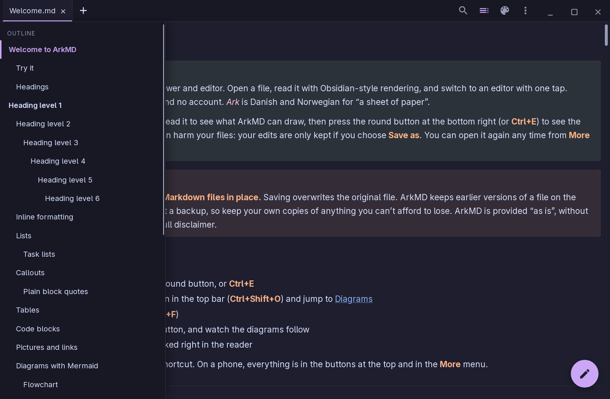

# Reading and editing

## Reading and editing modes

Each tab is either reading or editing. The reader draws the document with colored headings, callouts, tables and highlighted code. The editor shows the Markdown source with live coloring: headings are larger and colored, and the markup characters (`#`, `**`, `>`) are dimmed. Code inside fenced blocks is colored in the editor too.

The round button at the bottom right, or Ctrl+E, switches the current tab and keeps your scroll position. Each tab remembers its own mode.

## Find and replace

The magnifier in the top bar, or **Ctrl+F**, opens the find bar. Type to see every match, step through them with **Enter** and **Shift+Enter** (or the arrows, or F3), and use the buttons for **Aa** (match case), **ab** (whole word) and **.\*** (regular expression). The bar works in reading mode, where matches are highlighted in the page, and in the editor.

**Ctrl+H**, or the arrow at the left of the find bar, adds a replace row in the editor. **Replace** changes the current match and moves to the next; **Replace all** changes every match as one step you can undo. With regular expressions on, `$1` to `$9` in the replacement stand for the groups of the match and `$&` for the whole match. Reading mode has no replace: Ctrl+H switches to the editor first. In reading mode a match must sit inside one piece of formatting, so text split across bold or a link may not be found there; the editor finds it.

## Pictures (Windows and Linux)

Add a picture while editing in any of three ways: the image button in the formatting panel (or **Ctrl+Shift+I**), pasting a picture from the clipboard, or dragging an image file onto the window. ArkMD copies the file into an `images` folder next to your Markdown file, giving it a safe name (letters, digits, dashes and underscores; a number is added if the name is taken), and inserts `` at the cursor as its own paragraph, with the description selected so you can retype it. The picture is a copy, so the original stays where it was, and your Markdown file and its `images` folder can be moved or synced together.

- The document has to be saved first, because the folder goes next to it. An untitled document asks you to save it.
- PNG, JPEG, GIF, WebP, AVIF, BMP and SVG files up to 25 MB are accepted.
- Pasting works when the clipboard holds a picture and no text (a screenshot, say). It is saved as `pasted-` and the date and time. Where the web view doesn't hand the picture to ArkMD (as on some Linux setups), ArkMD reads it from the system clipboard itself; this reads the clipboard only at the moment you paste into the editor.
- Dropping several images inserts them all, one paragraph each. Dropping a Markdown file on the window opens it as a tab.
- Android doesn't have this yet.

## Task lists

In reading mode, tap or click a task's checkbox to tick or untick it. The change is made in the file's text like any edit: the file is marked as changed, Undo works in the editor, and Save writes it.

## Outline

The list button in the top bar (Ctrl+Shift+O) opens a flyout with the headings of the document, indented by level. Choose one to jump to it: the reader scrolls to the heading, and the editor puts the cursor at the start of its line. The section you are in is marked. Headings inside code blocks and front matter are not listed. Esc or a click outside closes the flyout. At the bottom it shows the word and character count of the document and an estimated reading time.



## Code in the editor

Fenced code blocks are colored in the editor with the same colors as in the reader. The editor knows these languages: JavaScript, TypeScript, Python, Rust, Java, Kotlin, C and C++, C#, Go, JSON, YAML, TOML, HTML and XML, CSS, SQL, shell, PowerShell, Lua, Ruby, diff and Dockerfile. Put the language after the opening fence (` ```python `); other languages are shown as plain code.

## Tabs

- Every open file is a tab in the top bar. Tap or click a tab to switch to it.
- Close a tab with its **✕**, by middle-clicking it, with Ctrl+W, or with the Android back button. A tab with unsaved changes shows a dot and asks before it closes.
- **Ctrl+Tab** and **Ctrl+Shift+Tab** (or Ctrl+PageDown and Ctrl+PageUp) move to the next and previous tab. With a tab focused, the left and right arrow keys move between tabs, Home and End jump to the first and last, and Delete closes it.
- Drag a tab sideways to change the order, or press **Ctrl+Shift+PageUp** and **Ctrl+Shift+PageDown** to move the current tab.
- Each tab keeps its own text, undo history, cursor and scroll position while you work in another.
- **+** opens a menu with **New file**, **Open file…** and your newest files. The clock button to its left opens the Recent files list (Ctrl+Shift+R).
- On Linux and Windows, opening another file from your file manager adds it as a tab in the window that is already open.

## The formatting panel

While you edit, a floating bar offers the most-used Markdown formatting, so you don't need to remember the syntax. The formatting button (**Tт**) in the top bar shows or hides it.

| Button | What it does |
|---|---|
| Heading | A menu of heading 1 to 6, or normal text |
| Bold, Italic, Strikethrough, Highlight, Inline code | Wraps the selection (`**`, `*`, `~~`, `==`, `` ` ``), or inserts an empty pair at the cursor |
| Link | Turns the selection into `[text](https://)` with the address selected |
| Bulleted list, Numbered list, Task | Applies to every selected line; switches between list types |
| Quote | Prefixes every selected line with `>` |
| Callout | A menu of callout types (note, tip, info, warning, danger, question, example, quote) |
| Code block | Wraps the selection in a fenced block |
| Image (Windows and Linux) | Choose a picture to copy next to the document and link (see Pictures below) |
| Table, Divider | Insert a table or a horizontal rule on its own lines |

In a table, **Tab** moves to the next cell and selects its text, **Shift+Tab** to the previous one, and Tab in the last cell adds a row.

Apply a format again to remove it: bold text becomes plain, a bulleted line becomes plain. Every formatting step can be undone.

## Keyboard shortcuts

**F1** (or **More** > **Settings** > **Keyboard shortcuts**, on desktop) lists them in the app. On macOS, Cmd works in place of Ctrl.

**Files and view**

| Keys | Action |
|---|---|
| Ctrl+O | Open a file |
| Ctrl+N or Ctrl+T | New file |
| Ctrl+S | Save |
| Ctrl+Shift+S | Save as |
| Ctrl+W | Close the current tab |
| Ctrl+Tab, Ctrl+Shift+Tab | Next, previous tab (also Ctrl+PageDown, Ctrl+PageUp) |
| Ctrl+E | Switch between reading and editing |
| Ctrl+Shift+O | Outline of the document |
| Ctrl+Shift+R | Recent files |
| Ctrl+D | Pin or unpin the file in this tab |
| Ctrl+F | Find |
| Ctrl+H | Find and replace (in the editor) |
| Enter, Shift+Enter, F3 | Next, previous match while the find bar is open |
| Ctrl+P | Print (desktop) |
| Ctrl+Shift+PageUp, Ctrl+Shift+PageDown | Move the current tab left, right |
| Ctrl+, | Settings |
| F1 | Keyboard shortcuts |
| Esc | Close a menu or dialog |
| Ctrl + and Ctrl − | Make the whole window larger or smaller (desktop) |

**Formatting, while editing**

| Keys | Action |
|---|---|
| Ctrl+1 to Ctrl+6 | Heading level 1 to 6 (press again to turn the line back into text) |
| Ctrl+0 | Normal text |
| Ctrl+B, Ctrl+I | Bold, italic |
| Ctrl+Shift+X | Strikethrough |
| Ctrl+Shift+H | Highlight |
| Ctrl+` | Inline code |
| Ctrl+K | Link |
| Ctrl+Shift+8 | Bulleted list |
| Ctrl+Shift+7 | Numbered list |
| Ctrl+Shift+9 | Task list |
| Ctrl+Shift+Q | Quote |
| Ctrl+Shift+K | Code block |
| Ctrl+Shift+I | Insert a picture (Windows and Linux) |
| Ctrl+Z, Ctrl+Shift+Z | Undo, redo |

Each list and style shortcut works on the selected lines or text, and pressing it again removes the formatting. With nothing selected, a style shortcut such as Ctrl+B opens a pair of marks; press it again after typing to step out past the closing marks.

**Writing flow**

- **Heading:** press Ctrl+2 on a line, or type `## `. With the cursor on a heading line, **Tab** makes it one level deeper (`##` becomes `###`) and **Shift+Tab** one level shallower, so you can step through the outline without retyping the marks.
- **Lists:** **Enter** continues a list with the next bullet, number or task; **Enter** on an empty item ends the list. **Tab** nests the current item (a numbered item moves in by three spaces so the nesting stays valid) and **Shift+Tab** moves it back out. This works on several selected items too.
- **Tables:** **Tab** and **Shift+Tab** move between cells, and Tab in the last cell adds a row.
- **Anywhere else**, Tab indents and Shift+Tab un-indents as usual.

Menus and dialogs work with the arrow keys and Esc, and the focus ring always shows where you are.
