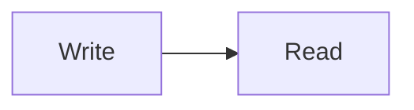

# Supported Markdown

The reader renders CommonMark and the usual GitHub extensions, plus several features from Obsidian. `samples/feature-tour.md` in the repository is a document that uses every feature below; open it in ArkMD to see them.

## Standard Markdown

- Headings 1 to 6, each in its own theme color.
- **Bold**, *italic*, ~~strikethrough~~ and `inline code`; links and bare web addresses (which become links); block quotes; bulleted, numbered and nested lists; horizontal rules.
- Tables, with column alignment.
- Task lists (`- [ ]` and `- [x]`). Click or tap a checkbox in the reader to tick it; the change is made in the file's text and saved with Save.
- Footnotes (`[^1]`).
- Fenced code blocks. Put the language after the opening fence (` ```python `); blocks without one are detected automatically. The reader colors them with highlight.js and the editor colors the languages listed under [Reading and editing](reading-and-editing.md#code-in-the-editor).
- Front matter, the `---` block at the top of a file, is shown as a box and isn't interpreted.
- Typographic quotes and dashes are applied when reading; the file itself is not changed.

## Diagrams

A fenced code block tagged `mermaid` is drawn as a diagram with [Mermaid](https://mermaid.js.org): flowcharts, sequence, class, state, entity-relationship, Gantt, pie, mind map, timeline and the other types Mermaid supports (version 11). The diagram follows the theme's colors and is redrawn when you switch themes. It prints and exports with the page. A diagram with a mistake shows Mermaid's error message above its source, so you can fix it in the editor. Diagrams are drawn with Mermaid's strict security level: no scripts, and no click actions. The Mermaid library is only loaded when a document contains a diagram, each diagram is drawn when you scroll near it (and remembered after that), and everything works offline.

````markdown

````

## From Obsidian

- **Callouts:** a block quote that starts with `[!type]` and an optional title becomes a colored callout. Types are `note`, `abstract` (`summary`, `tldr`), `info`, `todo`, `tip` (`hint`, `important`), `success` (`check`, `done`), `question` (`help`, `faq`), `warning` (`caution`, `attention`), `failure` (`fail`, `missing`), `danger` (`error`), `bug`, `example` and `quote` (`cite`). Add `-` after the type for a callout that starts collapsed, or `+` for a foldable one that starts open: `> [!info]- Details`.
- **Highlights:** `==text==`.
- **Wikilinks:** `[[Note]]`, `[[Note#Heading]]` and `[[Note|shown text]]` are drawn as links with a dashed underline. On Windows and Linux, clicking one opens `Note.md` from the same folder as the current file (the name is matched ignoring case, and a path such as `[[sub/Note]]` works); ArkMD has no vault, so it doesn't search other folders. On Android they don't open anything.
- **Tags:** `#tag` and nested tags such as `#project/ideas` are drawn as chips. A tag needs at least one letter.

## Not supported

Raw HTML (it's shown as text, not run), math, note embeds (`![[Note]]`), comments (`%%`), block references and plugins.

## Images

Images from the web (``) are shown, which means ArkMD loads them from that server, as any browser would.

On Windows and Linux, images next to the document are shown too: `` or ``, relative to the folder of the saved file (PNG, JPEG, GIF, WebP, AVIF, BMP and SVG, up to 25 MB each). An image that can't be found shows its description in a dashed box. To add one without typing the path, see Pictures under [Reading and editing](reading-and-editing.md#pictures-windows-and-linux). Absolute paths aren't loaded, and neither is anything on Android, where the system file picker gives ArkMD one file at a time.

## Links

Web and mail links open in your system browser. `[text](#heading)` jumps to a heading in the same document, using the heading's GitHub-style name (lower case, spaces as hyphens). On Windows and Linux a link to a Markdown file next to the document, such as `[notes](notes/other.md)` or `[part](other.md#second-part)`, opens that file in a new tab and jumps to the heading. Other kinds of link are ignored.
