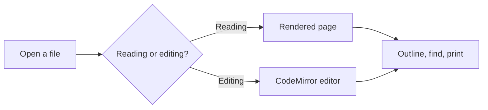
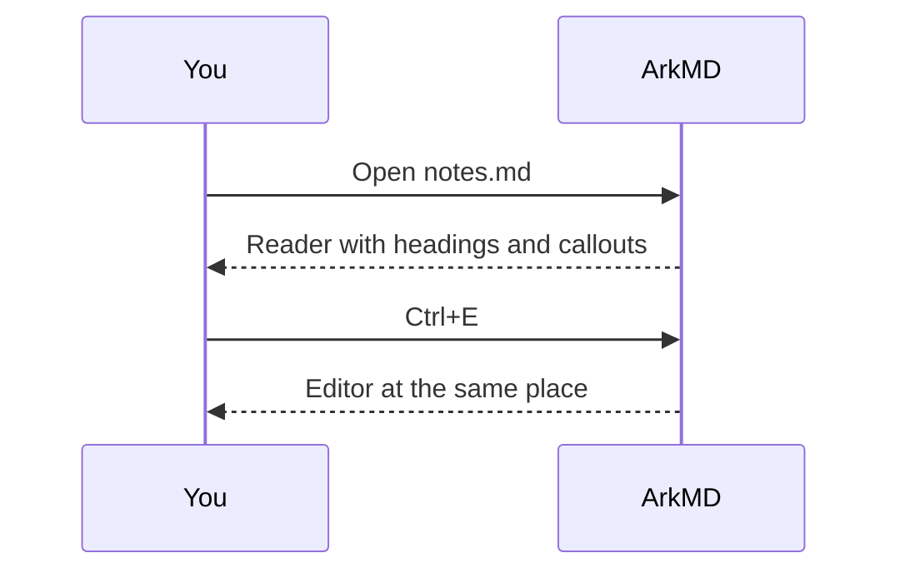

# H1: ArkMD Feature Tour

Welcome to **ArkMD**, a fast, local-first Markdown viewer and editor inspired by Nordic simplicity (*ark* = sheet of paper in Swedish, Norwegian, and Danish). This document tests every supported syntax element[^1].

## H2: Inline Typography & Links

### H3: Emphasis, Highlights & Inline Code

#### H4: Sub-section Heading Level 4

##### H5: Sub-section Heading Level 5

###### H6: Sub-section Heading Level 6

A single paragraph combining **bold text**, *italic text*, ***bold and italic***, ~~strikethrough text~~, ==highlighted key phrases==, and `inline code` spans like `val ark = Document.open(uri)`.

- Standard Markdown link: [CommonMark Specification](https://spec.commonmark.org/)
- Autolinked URL: https://github.com/
- Obsidian-style wikilink: [[Architecture Overview]]
- Wikilink with display alias: [[ theming/nord-palette | Nord Palette Guide ]]
- Inline hashtags: #markdown #arkmd/rendering #design/nordic/minimal

---

## H2: Lists & Task Checklists

1. First ordered step: open any local `.md` file from your file manager or the Open dialog.
2. Second ordered step: render immediately with zero vault lock-in.
   1. Nested ordered item 2.1
   2. Nested ordered item 2.2
3. Third ordered step: toggle live edit mode.

- Unordered list item A
  - Nested unordered item A.1
    - Deeply nested item A.1.a with `inline_code()` and ==highlight==
  - Nested unordered item A.2
- Unordered list item B

### Task List

- [x] Parse YAML front matter metadata block
- [x] Apply distinct H1–H6 palette heading colors
- [ ] Complete offline full-text search index
- [ ] Export rendered preview to print/PDF

---

## H2: Blockquotes & Obsidian Callouts

> "Simplicity is about subtracting the obvious and adding the meaningful."
> — John Maeda
>
> > Nested blockquote verifying multi-level quote border rendering and muted foreground contrast.

> [!note]
> Standard **Note** callout: ArkMD reads and writes plain UTF-8 `.md` files directly in place.

> [!tip] Keyboard & Toolbar Shortcuts
> Swipe the bottom formatting bar to insert `**bold**`, `==highlights==`, `[[wikilinks]]`, and fenced code blocks.

> [!warning] Unsaved changes
> A tab with unsaved changes shows a dot. Closing it asks before the changes are discarded.

> [!danger] Destructive Action Guard
> Deleting a local file removes it from device storage immediately; there is no cloud trash bin.

> [!question] Why no mandatory vault?
> Sometimes you just want to tap a `README.md` or a single note in your file manager and read it right away.

> [!example] Supported Extensions
> Recognizes `.md`, `.markdown`, `.mdown`, and `.mkd` files in file pickers and file managers.

> [!quote] Nordic Design Principle
> Clean lines, honest materials, and quiet contrast that never strains the eyes at night.

> [!info]- Foldable Info Callout (Collapsed by Default)
> This callout uses `[!info]-` so it starts collapsed and expands when tapped.

> [!todo]+ Release Checklist (Expanded Foldable Callout with Custom Title)
> - [x] Verify all 8 dark syntax themes (`tokyo-night`, `catppuccin-mocha`, `dracula`, `github-dark`, `monokai`, `rose-pine`, `one-dark-pro`, `nord`)
> - [ ] Run UI scroll smoothness benchmark on 5,000-line documents

---

## H2: GitHub-Flavored Markdown Table

| Feature | Syntax Example | Alignment | Status |
| :--- | :---: | ---: | :---: |
| Bold & Italic | `**bold**` / `*italic*` | Left | Done |
| Highlight | `==marked text==` | Center | Done |
| Wikilinks | `[[target\|alias]]` | Right | Done |
| Callouts | `> [!info]- Title` | Center | Done |

---

## H2: Fenced Code Blocks & Syntax Highlighting

```kotlin
package app.arkmd.viewer

data class DocumentMeta(val title: String, val wordCount: Int)

fun summarize(raw: String): DocumentMeta {
    val words = raw.trim().split(Regex("\\s+")).filter { it.isNotEmpty() }
    return DocumentMeta(title = "Feature Tour", wordCount = words.size)
}
```

```python
from pathlib import Path

def count_headings(path: Path) -> dict[int, int]:
    counts = {level: 0 for level in range(1, 7)}
    for line in path.read_text(encoding="utf-8").splitlines():
        if line.startswith("#"):
            level = len(line) - len(line.lstrip("#"))
            if 1 <= level <= 6 and line[level:level + 1] == " ":
                counts[level] += 1
    return counts
```

```javascript
export function parseWikilink(token) {
  const match = /^\[\[([^\]|]+)(?:\|([^\]]+))?\]\]$/.exec(token);
  if (!match) return null;
  return { target: match[1].trim(), alias: (match[2] ?? match[1]).trim() };
}
```

```bash
#!/usr/bin/env bash
set -euo pipefail
./gradlew :app:assembleDebug
adb install -r app/build/outputs/apk/debug/app-debug.apk
```

```json
{
  "app": "ArkMD",
  "dark": true,
  "defaultTheme": "tokyo-night",
  "supportedExtensions": [".md", ".markdown"]
}
```

```rust
pub fn strip_front_matter(input: &str) -> (&str, Option<&str>) {
    if let Some(rest) = input.strip_prefix("---\n") {
        if let Some(end) = rest.find("\n---\n") {
            return (&rest[end + 5..], Some(&rest[..end]));
        }
    }
    (input, None)
}
```

```
Plain fenced code block (no language tag specified)
├── samples/
│   └── feature-tour.md
└── themes.json
```

## H2: Diagrams

A fenced block tagged `mermaid` is drawn as a diagram in the theme's colors.





---

[^1]: Footnote verification: In Swedish, Norwegian, and Danish, *ett ark* / *et ark* means a clean sheet of paper, pairing naturally with `.md` for Markdown.
