# Welcome to ArkMD

> [!tip] Welcome
> ArkMD is a lightweight Markdown viewer and editor. Open a file, read it with Obsidian-style rendering, and switch to an editor with one tap. There is no vault, no plugin system and no account. *Ark* is Danish and Norwegian for "a sheet of paper".
>
> This document is built into the app. Read it to see what ArkMD can draw, then press the round button at the bottom right (or **Ctrl+E**) to see the Markdown behind it. Nothing here can harm your files: your edits are only kept if you choose **Save as**. You can open it again any time from **More** > **Welcome tour**.

> [!warning] Before you start
> ArkMD **opens, edits and saves your Markdown files in place.** Saving overwrites the original file. ArkMD keeps earlier versions of a file on the device, but that is a convenience, not a backup, so keep your own copies of anything you can't afford to lose. ArkMD is provided "as is", without warranty; the project page has the full disclaimer.

## Try it

- [ ] Switch to the editor and back: the round button, or **Ctrl+E**
- [ ] Open the outline from the list button in the top bar (**Ctrl+Shift+O**) and jump to [Diagrams](#diagrams-with-mermaid)
- [ ] Find a word with the magnifier (**Ctrl+F**)
- [ ] Open the clock button at the top left (**Ctrl+Shift+R**): your recent files, with previews, search and pins
- [ ] Change the look with the palette button, and watch the diagrams follow
- [ ] Tick this box: task boxes can be ticked right in the reader

On a desktop, **F1** lists every keyboard shortcut. On a phone, everything is in the buttons at the top and in the **More** menu.

---

## Headings

# Heading level 1
## Heading level 2
### Heading level 3
#### Heading level 4
##### Heading level 5
###### Heading level 6

Each level has its own color, set by the theme. In the editor, **Ctrl+1** to **Ctrl+6** set a level and **Tab** on a heading line makes it one level deeper.

## Inline formatting

Plain text, **bold**, *italic*, ***bold and italic***, ~~strikethrough~~, ==highlighted text==, `inline code`, and a [link](https://github.com/cj0r/arkmd). A bare address becomes a link too: https://github.com/cj0r/arkmd/releases. Typographic quotes, dashes and ellipses are applied while reading: "double", 'single', em--dash... The file itself isn't changed.

Obsidian-style extras: a [[Another note]] wikilink and a [[Another note|wikilink with an alias]] (on Windows and Linux, clicking one opens a file of that name from the same folder as the document you're reading), and tags such as #markdown, #diagrams and #project/arkmd/demo.

Front matter, the `---` block at the very top of a file, is shown as a box above the first heading; this document has none, so the welcome comes first.

A footnote lives at the bottom of the page.[^1] Press the number to jump to it, and the arrow to come back.

[^1]: Footnotes can hold **formatting** and [links](https://commonmark.org) too.

## Lists

- A bulleted list
  - nested one level
    - and another
- Another item
  1. A numbered list inside it
  2. Second step
     - back to bullets

1. First
2. Second
3. Third

### Task lists

- [x] Read this file
- [x] Switch the theme
- [ ] Tick this box in the reader (it is saved into the file)
- [ ] Open the outline with Ctrl+Shift+O
  - [x] A nested task that is already done
  - [ ] And one that isn't

## Callouts

> [!note] Note
> The default callout. Callouts hold **formatting**, lists and `code`.

> [!tip] Tip
> Press **F1** for every keyboard shortcut.

> [!info] Info
> Callouts take their color from the theme.

> [!success] Success
> Aliases such as `check` and `done` work too.

> [!question] Question
> Is this a question?

> [!warning] Warning
> Saving overwrites the original file. Keep your own backups.

> [!danger] Danger
> Raw HTML is never run.

> [!bug] Bug
> Something to fix.

> [!example] Example
> Text, then a list:
> - one
> - two

> [!quote] Quote
> "A sheet of paper." (*ark*, in Danish and Norwegian)

> [!abstract]- Foldable, starts closed
> Click the title to open it. Add `-` after the type for this, or `+` for one that starts open.

> [!todo]+ Foldable, starts open
> - [ ] Fold me up
> - [ ] Open me again

### Plain block quotes

> A normal quotation, without a callout type.
>
> > And a quote inside it.

## Tables

| Feature | Reader | Editor | Notes |
|:--------|:------:|:------:|------:|
| Headings | yes | yes | Colored per level |
| Task boxes | tick | type | Ticks are saved to the file |
| Find | yes | yes | Ctrl+F |
| Replace | no | yes | Ctrl+H |
| Diagrams | yes | source | Mermaid |

Columns can be aligned left, centered or right, as in the table above.

## Code blocks

```javascript
// Reader and editor share one set of syntax colors.
export function parseWikilink(token) {
  const match = /^\[\[([^\]|]+)(?:\|([^\]]+))?\]\]$/.exec(token);
  if (!match) return null;
  return { target: match[1].trim(), alias: (match[2] ?? match[1]).trim() };
}
```

```python
from pathlib import Path

def count_headings(path: Path) -> dict[int, int]:
    counts = {level: 0 for level in range(1, 7)}
    for line in path.read_text(encoding="utf-8").splitlines():
        if line.startswith("#"):
            counts[len(line) - len(line.lstrip("#"))] += 1
    return counts
```

```rust
pub fn strip_front_matter(input: &str) -> (&str, Option<&str>) {
    if let Some(rest) = input.strip_prefix("---\n") {
        if let Some(end) = rest.find("\n---\n") {
            return (&rest[end + 5..], Some(&rest[..end]));
        }
    }
    (input, None)
}
```

```kotlin
data class DocumentMeta(val title: String, val wordCount: Int)

fun summarize(raw: String): DocumentMeta {
    val words = raw.trim().split(Regex("\\s+")).filter { it.isNotEmpty() }
    return DocumentMeta(title = "Showcase", wordCount = words.size)
}
```

```go
func Outline(lines []string) []string {
	var out []string
	for _, l := range lines {
		if strings.HasPrefix(l, "#") {
			out = append(out, strings.TrimSpace(strings.TrimLeft(l, "#")))
		}
	}
	return out
}
```

```sql
SELECT level, COUNT(*) AS headings
FROM outline
WHERE file = 'notes.md'
GROUP BY level
ORDER BY level;
```

```bash
#!/usr/bin/env bash
set -euo pipefail
for f in *.md; do
  printf '%s: %s words\n' "$f" "$(wc -w < "$f")"
done
```

```json
{
  "name": "ArkMD",
  "formats": [".md", ".markdown", ".mdown", ".mkd"],
  "themes": "dozens",
  "diagrams": true
}
```

```yaml
title: Welcome to ArkMD
tags: [arkmd, welcome]
status: demo
```

```diff
- Saving overwrites the original file.
+ Saving overwrites the original file; earlier versions are kept on the device.
```

```css
:root {
  --bg: #fbf7ef;
  --fg: #2b2b2b;
  --accent: #b4540a;
}
```

```html
<!-- shown as code, never run -->
<script>alert("not executed")</script>
```

```
A block with no language tag is detected automatically,
or shown as plain text.
```

## Pictures and links

A picture, drawn from a file inside the app:


In your own documents, a picture next to the file is linked with a relative path, ``, and shows on Windows and Linux. On those systems the image button in the formatting panel (**Ctrl+Shift+I**), pasting, or dropping a file copies a picture into an `images` folder beside the document and writes the link for you. A picture that can't be found shows its description in a dashed box.

Links work like this: web addresses open in your browser; `[text](#heading)` jumps to a heading in the page, such as [back to the top](#welcome-to-arkmd); and on Windows and Linux a link such as `[notes](notes/other.md#part)` opens another Markdown file in a new tab.

## Diagrams with Mermaid

Each block below is a fenced code block tagged `mermaid`. The diagrams use the theme's colors, are redrawn when you change theme, and print and export with the page. If a diagram has a mistake, Mermaid's error appears above its source.

### Flowchart

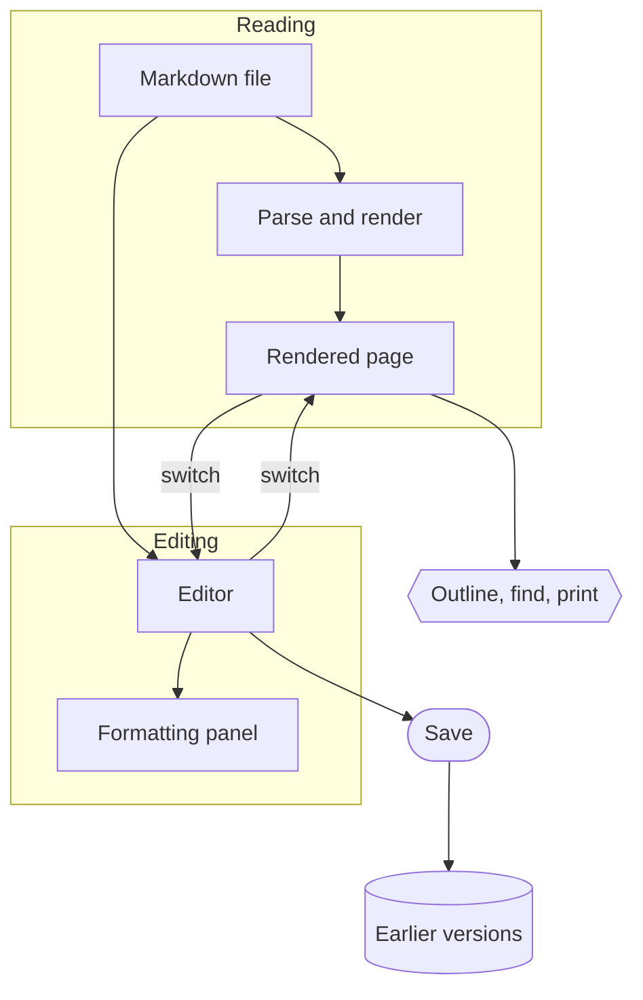

### Sequence diagram

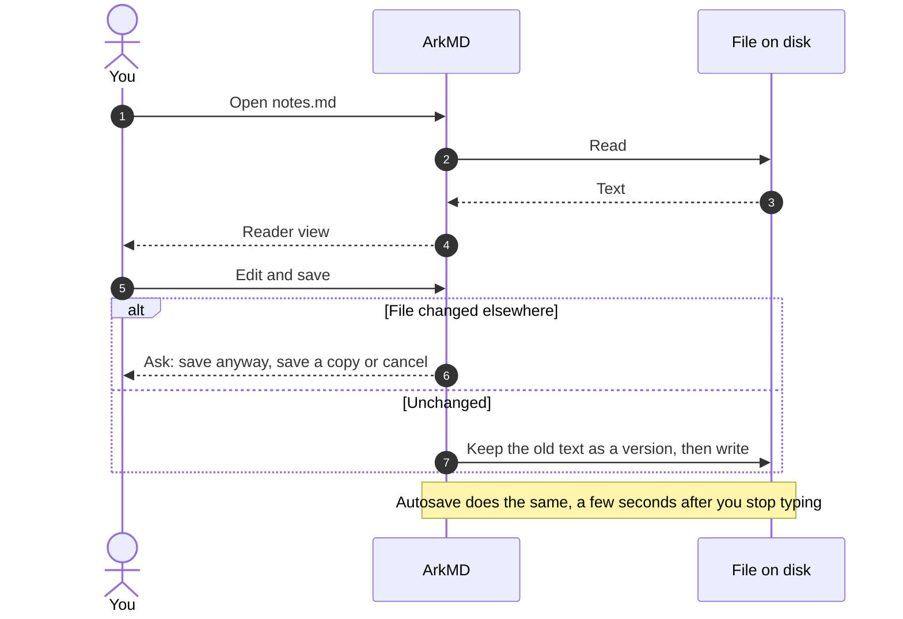

### Class diagram

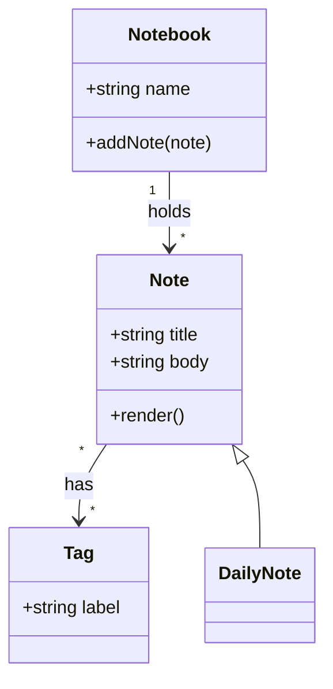

### State diagram

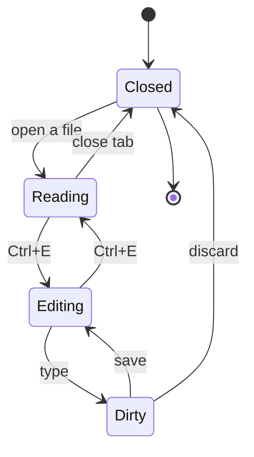

### Entity-relationship diagram

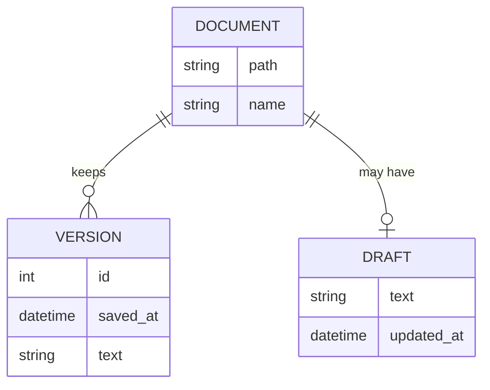

### Gantt chart

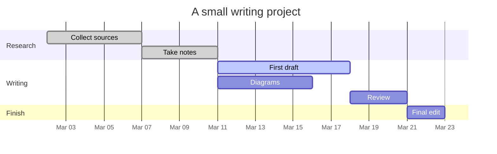

### Pie chart

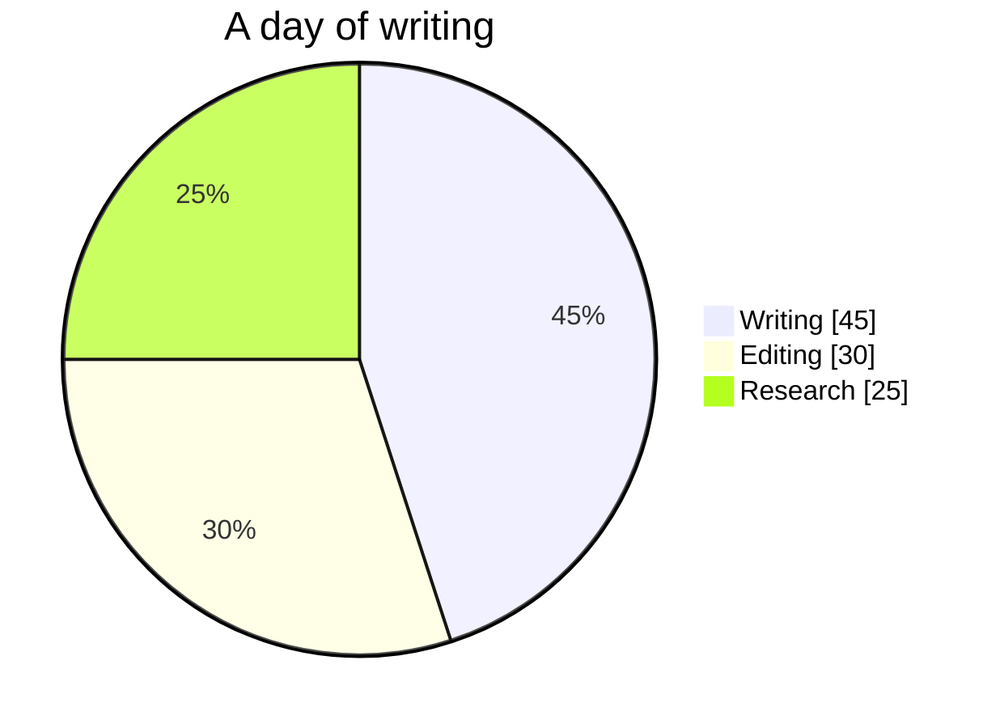

### Mind map

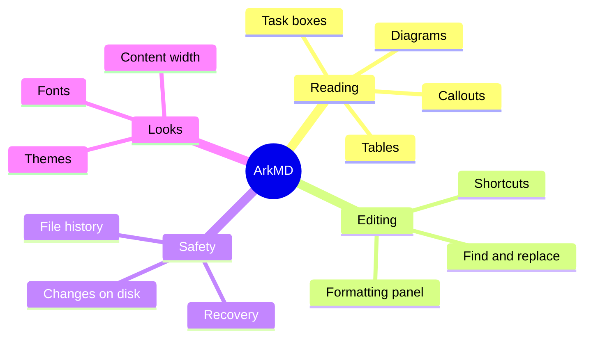

### Timeline

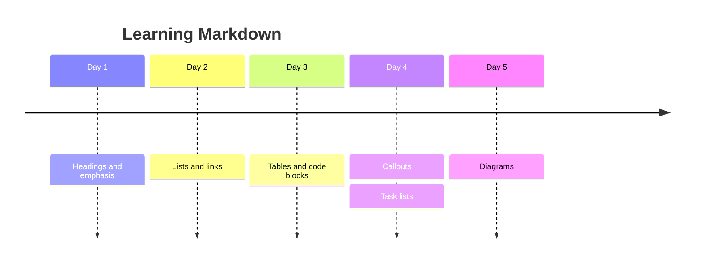

### Git graph

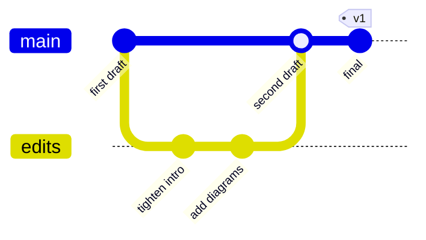

### User journey

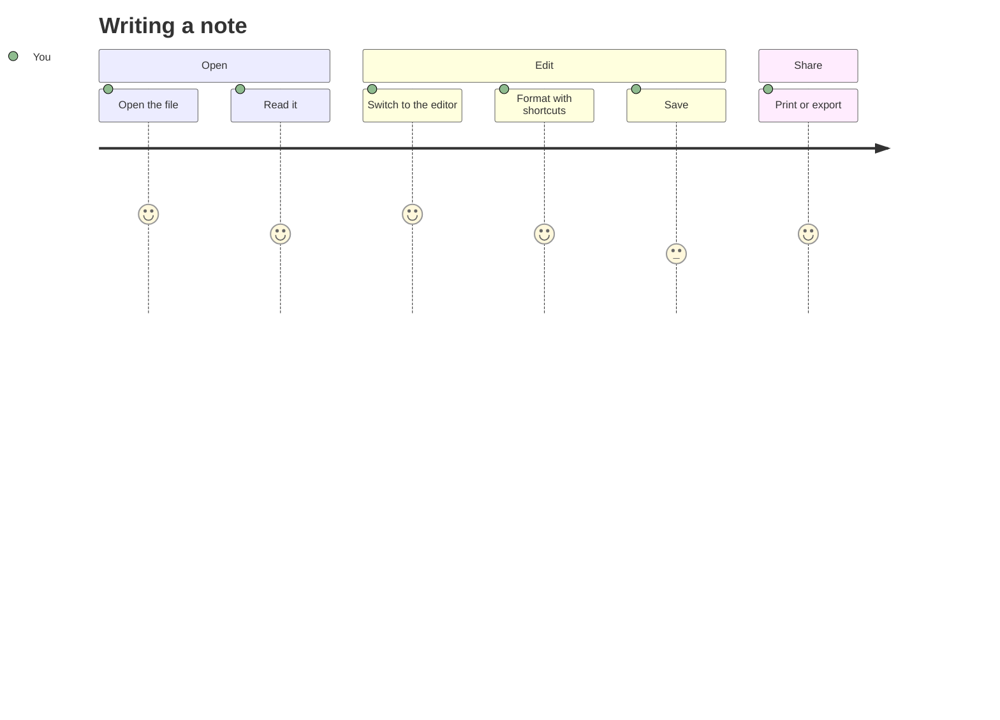

### Quadrant chart

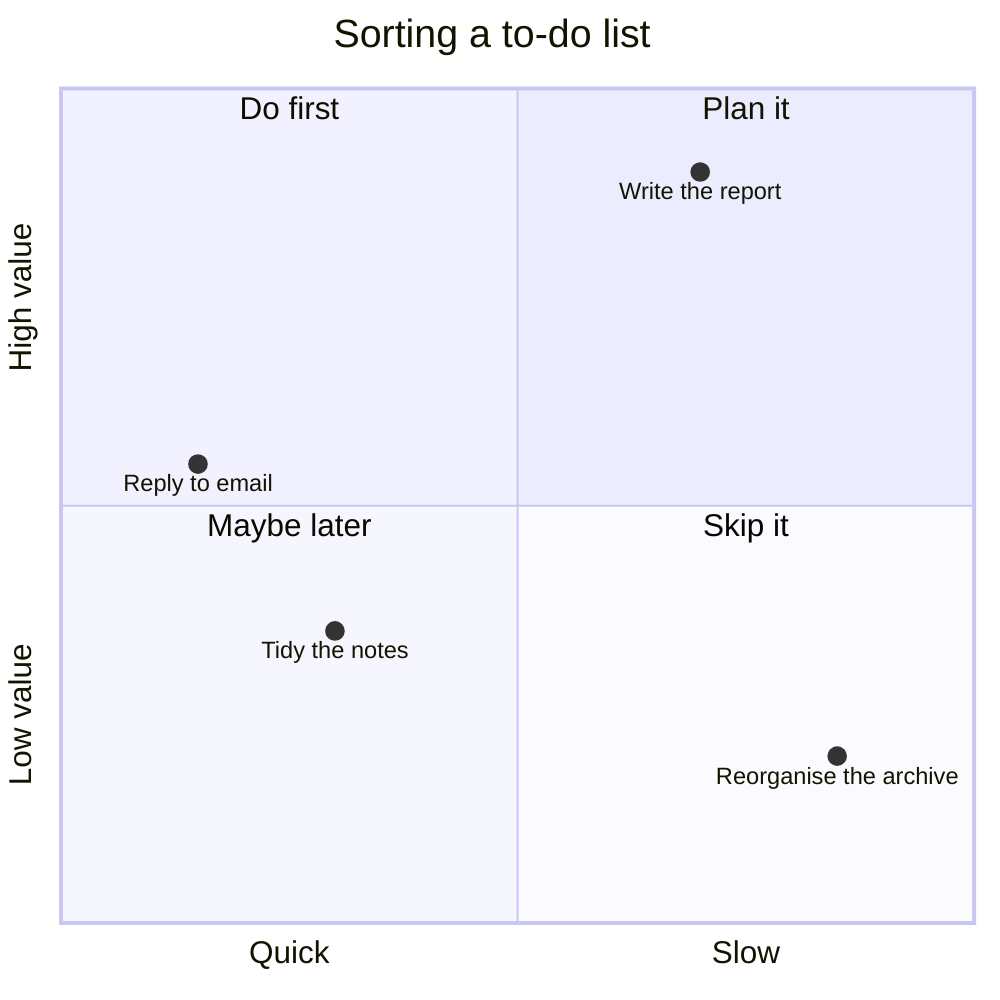

---

## What isn't drawn

Raw HTML (shown as text), math, note embeds (`![[Note]]`), `%%comments%%` and plugins. Everything else in this document is part of ArkMD.

## About ArkMD

ArkMD is free software under the GNU General Public License v3.0. The source code, the user guide, release notes and the issue tracker are at https://github.com/cj0r/arkmd. It works offline, has no account and collects no data; it contacts GitHub only when you check for updates.

ArkMD is developed with the help of AI coding tools (Claude). The maintainer reviews and tests the code, tests and documentation, and is responsible for each release. AI-assisted code can still contain mistakes, which is one more reason to keep backups of your files. If you find a bug, please [open an issue](https://github.com/cj0r/arkmd/issues).

## Support the project

If ArkMD is useful to you, you can support its development on [Ko-fi](https://ko-fi.com/cj000r) or [Buy Me a Coffee](https://www.buymeacoffee.com/cj0r). Every bit is appreciated.

*Thanks for trying ArkMD. Close this tab whenever you like; it's always under **More** > **Welcome tour**.*
